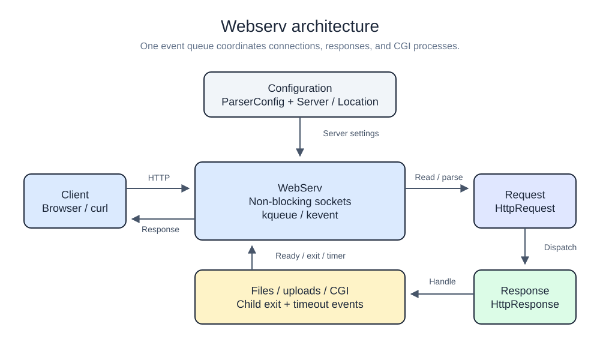
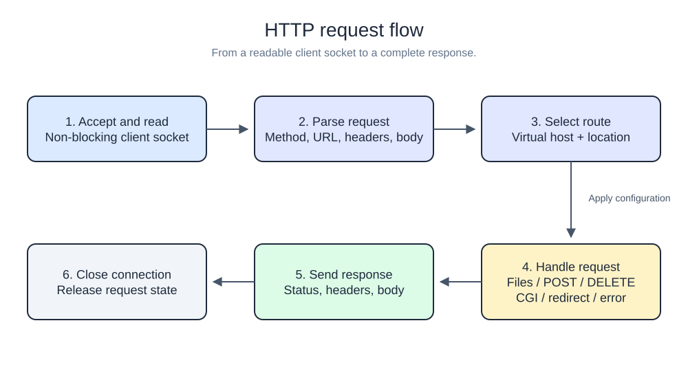

# Webserv

An HTTP/1.1 server built for the **42 Webserv project**. It handles client connections through non-blocking sockets and a `kqueue` event loop, with configurable routes, file uploads, and CGI execution.

## Features

- `GET`, `POST`, and `DELETE` request handling.
- Static files, index pages, and directory listings.
- Multiple server blocks, ports, and virtual hosts.
- Route-specific methods, redirects, and upload directories.
- Configurable error pages and request body limits.
- CGI execution with configured interpreters and a five-second timeout.
- Cookie and file-based session examples for `/cookie` and `/cookie2`.

## Getting started

### Requirements

- macOS: the source uses `kqueue` and macOS-specific system headers.
- A C++ compiler and `make`.
- Python, PHP, or a shell interpreter if enabled in your CGI configuration.

The Makefile specifies C++98, while the source uses C++11 features such as `std::unordered_map` and `std::to_string`. Build with the standard override below:

```sh
make FLAGS="-Wall -Wextra -Werror -std=c++11"
```

### Configure and run

From the repository root, save this example as `local.conf`. It serves the included HTML pages on port **8080**:

```nginx
server {
    listen 8080 127.0.0.1;
    server_name localhost;
    root ./pages_html;
    index upload.html;
    autoindex off;
    client_max_body_size 1048576;

    location / {
        allow_methods GET;
    }
}
```

Start the server:

```sh
./webserv local.conf
```

Open <http://127.0.0.1:8080> or check the response:

```sh
curl -i http://127.0.0.1:8080/
```

This example serves the upload page; accepting uploads requires a location with `POST` enabled and an existing, writable `upload_store` directory.

Running `./webserv` without arguments loads `ParseConfigFile/default.conf`. Update its machine-specific paths before using it. Run from the repository root so the built-in error pages and session directory resolve correctly.

## Configuration

The configuration uses `server` and `location` blocks. Directives end with a semicolon; `#` starts a comment.

| Directive | Scope | Purpose |
| --- | --- | --- |
| `listen` | Server | Port followed by an optional host, e.g. `8080 127.0.0.1`. |
| `server_name` | Server | Names matched against the request's `Host` header. |
| `root` | Server, location | Directory used to resolve requested files. |
| `index` | Server, location | Index filenames to look for in a directory. |
| `autoindex` | Server, location | Enable or disable directory listings with `on` or `off`. |
| `client_max_body_size` | Server | Maximum request body size in bytes. |
| `error_page` | Server | Map status codes to an error page. |
| `return` | Server, location | Redirect status code and destination. |
| `allow_methods` | Location | Allowed methods: `GET`, `POST`, `DELETE`. |
| `upload_store` | Location | Existing directory for uploaded files; required when `POST` is enabled. |
| `cgi_extension` | Location | Extension and interpreter path, e.g. `py /usr/bin/python3`. |

See [default.conf](ParseConfigFile/default.conf) for additional configuration examples.

## Architecture



Configuration is parsed before sockets are created. The event loop accepts connections, reads requests, and dispatches responses. CGI child processes and their timeout timers are monitored through the same event queue.

[Editable Excalidraw diagram](docs/diagrams/architecture.excalidraw)

## Request flow



The server selects a virtual host from the `Host` header, matches a location, and applies its configuration. The response layer handles files, uploads, deletion, redirects, CGI output, and errors. The connection closes after the response is complete.

[Editable Excalidraw diagram](docs/diagrams/request-flow.excalidraw)

To edit either diagram, download its `.excalidraw` file and open it in Excalidraw. SVG previews are included for display on GitHub.

## Project structure

```text
.
├── main.cpp             # Entry point and configuration selection
├── WebServ.cpp/.hpp     # Sockets, event loop, and CGI monitoring
├── ParseConfigFile/     # Configuration parser and examples
├── Configuration/       # Server and location settings
├── Request/             # HTTP request parsing and state
├── Response/            # Methods, CGI, and error responses
├── pages_html/          # Built-in status and upload pages
└── docs/diagrams/        # SVG previews and Excalidraw sources
```

## Build commands

| Command | Action |
| --- | --- |
| `make FLAGS="-Wall -Wextra -Werror -std=c++11"` | Build `webserv` and create the session directory. |
| `make clean` | Remove object files. |
| `make fclean` | Remove object files, the executable, and stored sessions. |
| `make re FLAGS="-Wall -Wextra -Werror -std=c++11"` | Clean and rebuild, including removal of stored sessions. |
